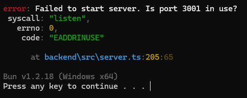
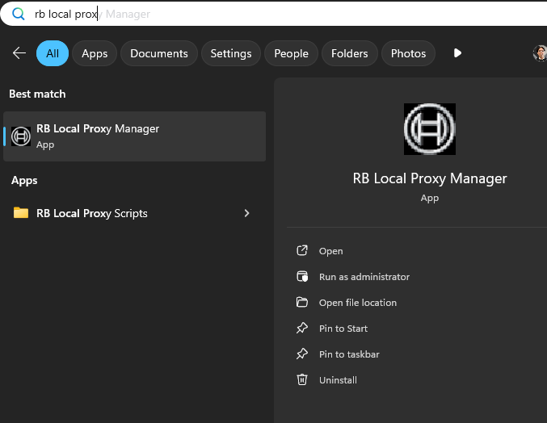
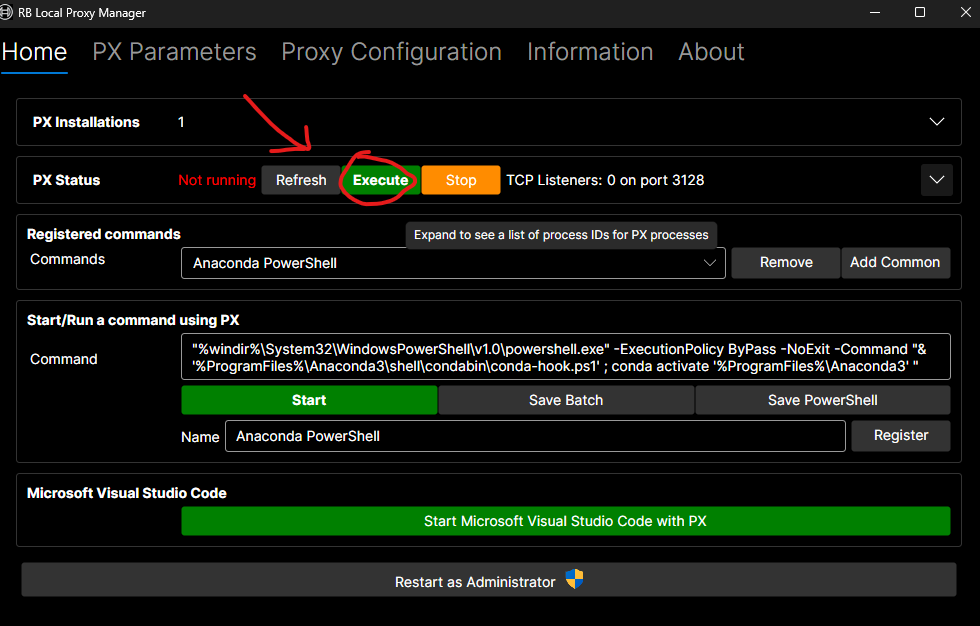

# ALMAutomation

This program is designed to be a standalone client which can fetch from the ALM API and create metrics with the help of the Bosch LLM Farm.

### Prerequisites:
To run this tool you'll need an LLM farm key and RB Local Proxy Manager
- Get your LLM Farm key [here](https://inside-docupedia.bosch.com/confluence2/genaiplatform/llm-farm-372737736.html).
- Get RB Local Proxy Manager [here](https://service-management.bosch.tech/sp?id=sc_cat_item&sys_id=b08ed16c1b83c91078087403dd4bcbb1)

### Install and Run:
1. Download the installer from releases and run it, provide the API key you recieved from Bosch.
2. Ensure RB Local Proxy Manager is running Px (see below)
3. Run ALMAutomation.exe, it should open a terminal (and stay open)
4. Then open the server url on your web browser, typically `https://localhost:3001` 

### Troubleshooting:
If the terminal instantly closes, put the following code in a text file in the same directory as the executable, rename it to `start.bat` then run the file to view the error.
```
@echo off
ALMAutomation.exe
pause
```
If the terminal gives you an error that the port is in use, you may have another program running on that port in which case change the PORT value in `./secrets/.env`


### Running RB Local Proxy Manager with Px:
Run RB Local Proxy Manager\
 \
Click execute on Px status\
\
Make sure the port is `3128`!

## Build from source:
1. Clone the repo
2. Install [Bun](https://bun.com/)
3. Run `bun install` to install the dependencies

### Run:
- Use `bun run dev` and open `localhost:5222`
- To compile, use `bun run compile`
- To create installer, compile `./install.iss` with InnoSetup 
  - Make sure to change the file paths!

## Details
- React/TS/Vite frontend at `http://localhost:5222`, 
- Express/TS backend at `https://localhost:3001`.
- Compiled/Static runs at `https://localhost:3001`.
- If using AI features at work, you will need to be using RB Local Proxy Manager and running PX through it to local proxy.\
- Currently this program uses basic authentication, we plan to move to a better system in future. *NOT SECURE*